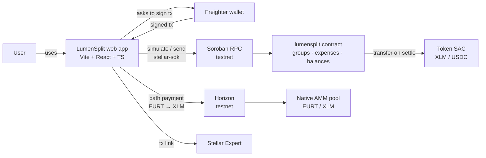
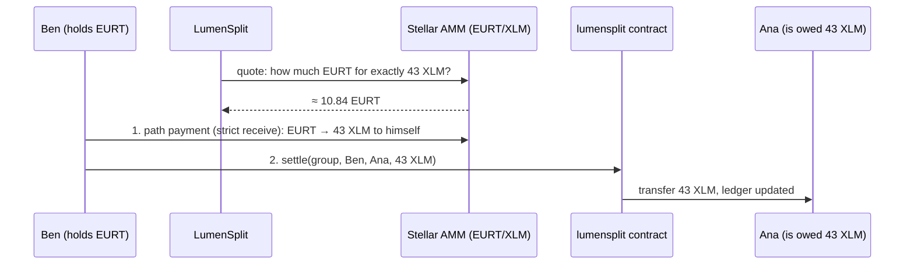

<p align="center">
  
</p>

<p align="center"><b>Split bills with friends. Settle up in seconds, from anywhere.</b><br>
Shared expenses tracked in a Soroban smart contract, debts paid with real money on Stellar.</p>

<p align="center">
  <a href="#demo">Demo</a> ·
  <a href="#how-it-works">How it works</a> ·
  <a href="#smart-contract-api">Contract API</a> ·
  <a href="#run-it-locally">Run it</a> ·
  <a href="#deployed-on-testnet">Testnet IDs</a>
</p>

---

Built at **HackMeridian** (Lisbon, 25–26 Oct 2026) · Track: **Genesis** · Themes: **Stellar Unlocked / Stellar Composed**

## The problem

Trips, shared flats, Erasmus semesters: groups share expenses all the time. Apps like Splitwise or Tricount keep track of who owes what, but **the payback happens somewhere else** ("I'll send it to you later"), and often it never happens.

Across borders it gets worse. An international student in Lisbon paying back a friend in Germany or Brazil deals with slow transfers, FX spreads and fees that can be bigger than the debt itself. Small debts linger, and someone always ends up out of pocket.

## The solution

LumenSplit puts **tracking and paying in the same place**.

1. Create a group and add your friends.
2. Log expenses. They are split equally and everyone sees their balance (green = you're owed, red = you owe).
3. Tap **Settle up**. The contract computes the **fewest payments** needed to bring everyone back to zero.
4. Tap **Pay**. Real tokens (XLM or USDC) move on Stellar in about 5 seconds for a fraction of a cent, and the shared ledger updates at once.
5. Only hold euros? Tap **Pay in euros**. Stellar's built-in exchange converts them on the fly, and your friend receives exactly what they are owed.

The group's ledger lives in a Soroban smart contract: nobody can rewrite history, and every payment has a public receipt on the explorer.

### Why Stellar
- **Instant and nearly free**: ~5 s finality and fees around 0.00001 XLM, so paying back 3 € finally makes sense.
- **Stablecoins**: a group can settle in USDC, so nobody is exposed to volatility.
- **Stellar Asset Contracts**: the contract moves native assets directly with `transfer`, without wrapping.
- **Path payments + native AMM** (built): pay in your currency and the network converts it at the best available rate, in the same few seconds.
- **Anchors** (roadmap): cash out to a bank account.

### What makes it different
- **On-chain debt simplification**: `suggest_settlements` turns a tangle of debts into the minimum list of transfers, computed by the contract so everyone sees the same answer.
- **Safe one-tap settlement**: `settle` only lets you pay what you actually owe to someone who is actually owed. No overpaying.
- **Pay in any currency**: a debtor can pay in EURT (our demo euro) while the group settles in XLM. A path payment routes the euros through Stellar's native AMM, so the person who is owed gets the exact amount. No bridge, no third-party exchange.
- **No crypto jargon**: the UI talks about amounts, names and "Pay". The wallet is the only hint that it runs on a blockchain.

## Demo

🎬 **Video (2–3 min):** _TODO: add YouTube/Loom link_

| Home | Group | Settle up |
|---|---|---|
| _TODO screenshot_ | _TODO screenshot_ | _TODO screenshot_ |

Design wireframes: [`docs/wireframes/`](docs/wireframes/) · Brand: [`docs/brand/`](docs/brand/)

## How it works



- **Contract** (`contracts/lumensplit/`): Rust/Soroban. Stores groups, expenses and a balance per member. Every expense keeps the group ledger summing to zero.
- **Frontend** (`frontend/`): Vite + React + TypeScript, `@stellar/stellar-sdk` and `@stellar/freighter-api` for signing. The contract client is built at runtime from the on-chain contract spec (`contract.Client.from`), so there is no code-generation step to keep in sync.
- **Wallet**: Freighter signs every write (`create_group`, `add_expense`, `settle`). Reads are simulated, so they need no signature.

### Pay in euros: how a cross-currency settlement works



Two signatures are needed because a Soroban contract call cannot share a transaction with classic operations. The path payment is *strict receive*: the amount Ana gets is exact, and Ben's maximum spend is capped at the quote plus 1% slippage. Code: [`frontend/src/lib/pathpay.ts`](frontend/src/lib/pathpay.ts).

## Engineering notes

**Cutting the cost of creating a group from ~4,700 XLM to ~6 XLM.** Our first deployment extended the storage TTL of every entry to 90 days on every write. On testnet, the rent paid up front made `create_group` cost **4,701 XLM** in fees (measured on Stellar Expert), enough to drain a Friendbot account in two groups. We removed the per-write extensions and let new entries take the network's minimum lifetime. Creating a group plus two expenses now costs **~6.8 XLM**, about 700× cheaper, with no change to the public API. A production version would extend TTL lazily, only when an entry is close to expiring.

**The ledger always sums to zero.** Equal splits leave remainders (100 split by 3). The contract gives the extra units to the first participants, so balances are exact to the smallest unit and `suggest_settlements` can always clear the group.

**Debt simplification** matches the largest debtor with the largest creditor until everyone is at zero, which needs at most *members − 1* transfers.

## Smart contract API

| Function | Signature | What it does |
|---|---|---|
| `create_group` | `(creator: Address, name: String, token: Address, members: Vec<Address>) -> u32` | Creates a group. `token` is the settlement asset (XLM or USDC SAC). The creator signs and must be a member. Returns the group id. |
| `add_expense` | `(group_id: u32, payer: Address, amount: i128, description: String, participants: Vec<Address>)` | The payer signs. Splits equally; the remainder goes to the first participants so the group always sums to 0. |
| `add_expense_custom` | `(group_id: u32, payer: Address, description: String, shares: Vec<Share{member, amount}>)` | The payer signs. Each participant owes a different amount; the expense total is the sum of the shares. |
| `settle` | `(group_id: u32, from: Address, to: Address, amount: i128)` | `from` signs. Transfers real tokens from `from` to `to` and updates balances. Only if `from` owes and `to` is owed; cannot overpay. |
| `settle_all` | `(group_id: u32, from: Address) -> Vec<Transfer>` | `from` signs once. Pays every debt `from` has in the group, following `suggest_settlements`, in one atomic transaction: all transfers succeed or none do. |
| `suggest_settlements` | `(group_id: u32) -> Vec<Transfer{from, to, amount}>` | Debt simplification: minimal list of payments that leaves everyone at 0. |
| `create_invite` | `(group_id: u32, member: Address, code_hash: BytesN<32>)` | A member signs. Stores only the SHA-256 of a secret invite code; a new invite replaces the previous one. |
| `join_group` | `(group_id: u32, member: Address, code: Bytes)` | The new member signs. Joins with balance 0 if `sha256(code)` matches the invite. |
| `get_group` | `(group_id: u32) -> Group{id, name, token, members}` | Read |
| `get_balances` | `(group_id: u32) -> Map<Address, i128>` | Positive = is owed, negative = owes |
| `get_expenses` | `(group_id: u32) -> Vec<Expense{payer, amount, description, participants, shares, timestamp}>` | Read. `shares[i]` is what `participants[i]` owes for that expense. |
| `group_count` | `() -> u32` | Number of groups (ids go from 1 to N) |

Amounts are `i128` in the token's smallest unit (XLM and USDC use 7 decimals: 1 XLM = 10_000_000).

**Errors:** 1 `GroupNotFound` · 2 `NotAMember` · 3 `InvalidAmount` · 4 `NoParticipants` · 5 `EmptyGroup` · 6 `DuplicateMember` · 7 `NothingToSettle` · 8 `AmountTooLarge` · 9 `SelfSettlement` · 10 `AlreadyMember` · 11 `InvalidInvite` · 12 `NoInvite`

**Tests:** 15 unit tests cover group creation, equal splits and remainders, custom splits (and their validation), outsiders being rejected, settlement moving tokens, overpay protection, `settle_all` paying several creditors in one call, invites (valid, wrong code, no invite, already a member, non-members creating invites) and suggested settlements clearing all debts.

**Invite links without leaking the code.** The link looks like `https://app/join/7#<code>`. Everything after `#` stays in the browser and is never sent to any server. The contract only stores `sha256(code)`, so reading the chain does not reveal how to join a group.

## Run it locally

### Prerequisites
- Rust + `wasm32v1-none` target, [Stellar CLI](https://developers.stellar.org/docs/tools/cli)
- Node.js 20+
- [Freighter](https://www.freighter.app/) browser extension, set to **Testnet**, with an account funded by Friendbot

### Contract
```bash
cargo test
stellar contract build
stellar contract deploy \
  --wasm target/wasm32v1-none/release/lumensplit.wasm \
  --source dev --network testnet --alias lumensplit
```
### Demo data
```bash
# Demo accounts (testnet only)
for u in ana ben carla; do stellar keys generate $u --network testnet --fund; done

# Group "Lisbon trip" with 5 expenses: ana +43, ben −59, carla +16
./scripts/demo-seed.sh

# Demo euro (EURT), an EURT/XLM AMM pool, and 500 EURT for each demo account
cd frontend
BEN_SECRET=$(stellar keys show ben) CARLA_SECRET=$(stellar keys show carla) \
ANA_SECRET=$(stellar keys show ana) node scripts/setup-eurt.mjs
```

### Frontend
```bash
cd frontend
cp .env.example .env   # fill VITE_CONTRACT_ID and VITE_TOKEN_ID
npm install
npm run dev
```

`.env` keys:
```
VITE_CONTRACT_ID=...
VITE_TOKEN_ID=...
VITE_NETWORK=testnet
VITE_RPC_URL=https://soroban-testnet.stellar.org
VITE_PAY_ASSET=EURT:<issuer>   # printed by setup-eurt.mjs; hides "Pay in euros" if empty
```

## Deployed on testnet

| What | ID |
|---|---|
| LumenSplit contract | `CBXEGK22M2QADBUTYZLPFVUIH2GLCBAVRWA5P5TBG5YA27OJMZP37ICO` ([explorer](https://stellar.expert/explorer/testnet/contract/CBXEGK22M2QADBUTYZLPFVUIH2GLCBAVRWA5P5TBG5YA27OJMZP37ICO)) |
| Settlement token (native XLM SAC) | `CDLZFC3SYJYDZT7K67VZ75HPJVIEUVNIXF47ZG2FB2RMQQVU2HHGCYSC` ([explorer](https://stellar.expert/explorer/testnet/contract/CDLZFC3SYJYDZT7K67VZ75HPJVIEUVNIXF47ZG2FB2RMQQVU2HHGCYSC)) |
| Demo euro asset (EURT) | `EURT:GARXWCPKKRVKGJ5D2ESLXF4LZKN5PFTSB5Z6WJK72RBUJV5TB33GP5B2` ([explorer](https://stellar.expert/explorer/testnet/asset/EURT-GARXWCPKKRVKGJ5D2ESLXF4LZKN5PFTSB5Z6WJK72RBUJV5TB33GP5B2)) |
| EURT/XLM liquidity pool | `e81a98ae098802a5b8412fd30cd9ec8c1b813b59c27bc147768adb8a221382e6` ([explorer](https://stellar.expert/explorer/testnet/liquidity-pool/e81a98ae098802a5b8412fd30cd9ec8c1b813b59c27bc147768adb8a221382e6)) |

EURT is a demo token we issued on testnet to make cross-currency payments reproducible. In production the same code works with EURC or USDC, since the path is found by the network at payment time.

## Roadmap
1. **Now (hackathon):** groups, expenses, balances, minimal settlements, real payments on testnet, and paying in euros through path payments.
2. **Next:** real stablecoins (EURC, USDC) as group and payment assets; pay several debts in one tap.
3. **Then:** cash out to a bank account through Stellar anchors (SEP-24), invite friends with a link, recurring expenses.
4. **Later:** mainnet, mobile app, passkey wallets so friends don't need to install anything.

## Team
| | Role |
|---|---|
| Manu | Soroban contract, deployment, integration |
| Gregorio | Frontend |
| Alex | Design/UX, README, pitch and demo video |

## Use of AI
In line with the hackathon rules, we used AI assistants during development. Claude (Anthropic) helped with: contract code review and tests, frontend scaffolding and integration code, the visual identity (palette, logo, wireframes), and drafting this README, the pitch deck and the video script. All AI output was reviewed, tested and edited by the team.

## License
MIT
