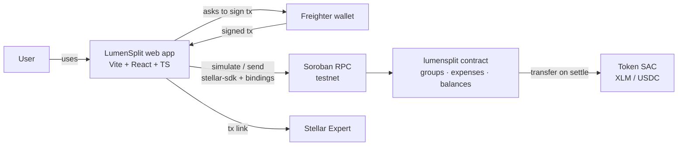

<p align="center">
  
</p>

<p align="center"><b>Split bills with friends. Settle up in seconds, from anywhere.</b><br>
Shared expenses tracked in a Soroban smart contract, debts paid with real money on Stellar.</p>

<p align="center">
  <a href="#demo">Demo</a> ·
  <a href="#how-it-works">How it works</a> ·
  <a href="#smart-contract-api">Contract API</a> ·
  <a href="#run-it-locally">Run it</a> ·
  <a href="#deployed-on-testnet">Testnet IDs</a>
</p>

---

Built at **HackMeridian** (Lisbon, 25–26 Oct 2026) · Track: **Genesis** · Themes: **Stellar Unlocked / Stellar Composed**

## The problem

Trips, shared flats, Erasmus semesters: groups share expenses all the time. Apps like Splitwise or Tricount keep track of who owes what, but **the payback happens somewhere else** ("I'll send it to you later"), and often it never happens.

Across borders it gets worse. An international student in Lisbon paying back a friend in Germany or Brazil deals with slow transfers, FX spreads and fees that can be bigger than the debt itself. Small debts linger, and someone always ends up out of pocket.

## The solution

LumenSplit puts **tracking and paying in the same place**.

1. Create a group and add your friends.
2. Log expenses. They are split equally and everyone sees their balance (green = you're owed, red = you owe).
3. Tap **Settle up**. The contract computes the **fewest payments** needed to bring everyone back to zero.
4. Tap **Pay**. Real tokens (XLM or USDC) move on Stellar in about 5 seconds for a fraction of a cent, and the shared ledger updates at once.

The group's ledger lives in a Soroban smart contract: nobody can rewrite history, and every payment has a public receipt on the explorer.

### Why Stellar
- **Instant and nearly free**: ~5 s finality and fees around 0.00001 XLM, so paying back 3 € finally makes sense.
- **Stablecoins**: a group can settle in USDC, so nobody is exposed to volatility.
- **Stellar Asset Contracts**: the contract moves native assets directly with `transfer`, without wrapping.
- **Path payments and anchors** (roadmap): pay in your currency, your friend receives theirs, and cash out to a bank.

### What makes it different
- **On-chain debt simplification**: `suggest_settlements` turns a tangle of debts into the minimum list of transfers, computed by the contract so everyone sees the same answer.
- **Safe one-tap settlement**: `settle` only lets you pay what you actually owe to someone who is actually owed. No overpaying.
- **No crypto jargon**: the UI talks about amounts, names and "Pay". The wallet is the only hint that it runs on a blockchain.

## Demo

🎬 **Video (2–3 min):** _TODO: add YouTube/Loom link_

| Home | Group | Settle up |
|---|---|---|
| _TODO screenshot_ | _TODO screenshot_ | _TODO screenshot_ |

Design wireframes: [`docs/wireframes/`](docs/wireframes/) · Brand: [`docs/brand/`](docs/brand/)

## How it works



- **Contract** (`contracts/lumensplit/`): Rust/Soroban. Stores groups, expenses and a balance per member. Every expense keeps the group ledger summing to zero.
- **Frontend** (`frontend/`): Vite + React + TypeScript, `@stellar/stellar-sdk`, TypeScript bindings generated with `stellar contract bindings typescript`, and `@stellar/freighter-api` for signing.
- **Wallet**: Freighter signs every write (`create_group`, `add_expense`, `settle`). Reads are simulated, so they need no signature.

## Smart contract API

| Function | Signature | What it does |
|---|---|---|
| `create_group` | `(creator: Address, name: String, token: Address, members: Vec<Address>) -> u32` | Creates a group. `token` is the settlement asset (XLM or USDC SAC). The creator signs and must be a member. Returns the group id. |
| `add_expense` | `(group_id: u32, payer: Address, amount: i128, description: String, participants: Vec<Address>)` | The payer signs. Splits equally; the remainder goes to the first participants so the group always sums to 0. |
| `settle` | `(group_id: u32, from: Address, to: Address, amount: i128)` | `from` signs. Transfers real tokens from `from` to `to` and updates balances. Only if `from` owes and `to` is owed; cannot overpay. |
| `suggest_settlements` | `(group_id: u32) -> Vec<Transfer{from, to, amount}>` | Debt simplification: minimal list of payments that leaves everyone at 0. |
| `get_group` | `(group_id: u32) -> Group{id, name, token, members}` | Read |
| `get_balances` | `(group_id: u32) -> Map<Address, i128>` | Positive = is owed, negative = owes |
| `get_expenses` | `(group_id: u32) -> Vec<Expense{payer, amount, description, participants, timestamp}>` | Read |
| `group_count` | `() -> u32` | Number of groups (ids go from 1 to N) |

Amounts are `i128` in the token's smallest unit (XLM and USDC use 7 decimals: 1 XLM = 10_000_000).

**Errors:** 1 `GroupNotFound` · 2 `NotAMember` · 3 `InvalidAmount` · 4 `NoParticipants` · 5 `EmptyGroup` · 6 `DuplicateMember` · 7 `NothingToSettle` · 8 `AmountTooLarge` · 9 `SelfSettlement`

**Tests:** 7 unit tests cover group creation, equal splits and remainders, outsiders being rejected, settlement moving tokens, overpay protection and suggested settlements clearing all debts.

## Run it locally

### Prerequisites
- Rust + `wasm32v1-none` target, [Stellar CLI](https://developers.stellar.org/docs/tools/cli)
- Node.js 20+
- [Freighter](https://www.freighter.app/) browser extension, set to **Testnet**, with an account funded by Friendbot

### Contract
```bash
cargo test
stellar contract build
stellar contract deploy \
  --wasm target/wasm32v1-none/release/lumensplit.wasm \
  --source dev --network testnet --alias lumensplit
```
A full CLI walkthrough (create group → add expense → balances → settle) is in [`docs/demo-cli.md`](docs/demo-cli.md).

### Frontend
```bash
cd frontend
cp .env.example .env   # fill VITE_CONTRACT_ID and VITE_TOKEN_ID
npm install
npm run dev
```

`.env` keys:
```
VITE_CONTRACT_ID=...
VITE_TOKEN_ID=...
VITE_NETWORK=testnet
VITE_RPC_URL=https://soroban-testnet.stellar.org
```

## Deployed on testnet

| What | ID |
|---|---|
| LumenSplit contract | `CBRITZ5L3VGUCHRXWL5RFLVKGH2I3SGS3K2BUDQXW34BIOZYUN3QJMQF` ([explorer](https://stellar.expert/explorer/testnet/contract/CBRITZ5L3VGUCHRXWL5RFLVKGH2I3SGS3K2BUDQXW34BIOZYUN3QJMQF)) |
| Settlement token (native XLM SAC) | `CDLZFC3SYJYDZT7K67VZ75HPJVIEUVNIXF47ZG2FB2RMQQVU2HHGCYSC` ([explorer](https://stellar.expert/explorer/testnet/contract/CDLZFC3SYJYDZT7K67VZ75HPJVIEUVNIXF47ZG2FB2RMQQVU2HHGCYSC)) |

## Roadmap
1. **Now (hackathon):** groups, expenses, balances, minimal settlements and real payments on testnet.
2. **Next:** pay in your own currency with path payments (EUR → USDC → XLM).
3. **Then:** cash out to a bank account through Stellar anchors (SEP-24), invite friends with a link, recurring expenses.
4. **Later:** mainnet, mobile app, passkey wallets so friends don't need to install anything.

## Team
| | Role |
|---|---|
| Manu | Soroban contract, deployment, integration |
| Gregorio | Frontend |
| Alex | Design/UX, README, pitch and demo video |

## Use of AI
In line with the hackathon rules, we used AI assistants during development. Claude (Anthropic) helped with: contract code review and tests, frontend scaffolding and integration code, the visual identity (palette, logo, wireframes), and drafting this README, the pitch deck and the video script. All AI output was reviewed, tested and edited by the team.

## License
MIT
