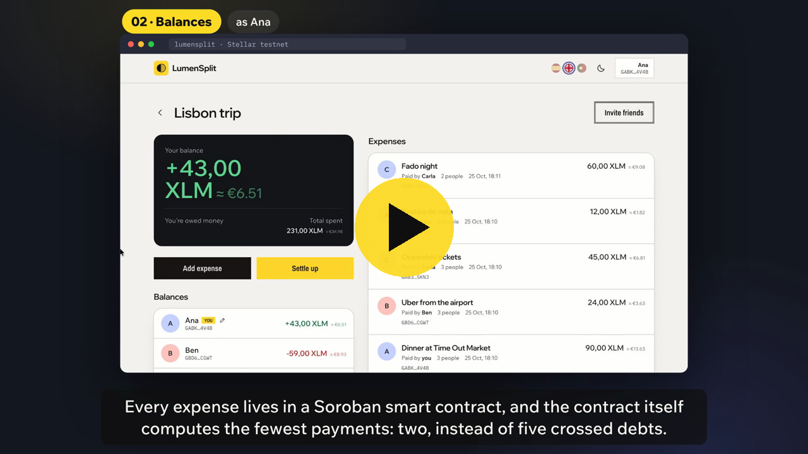
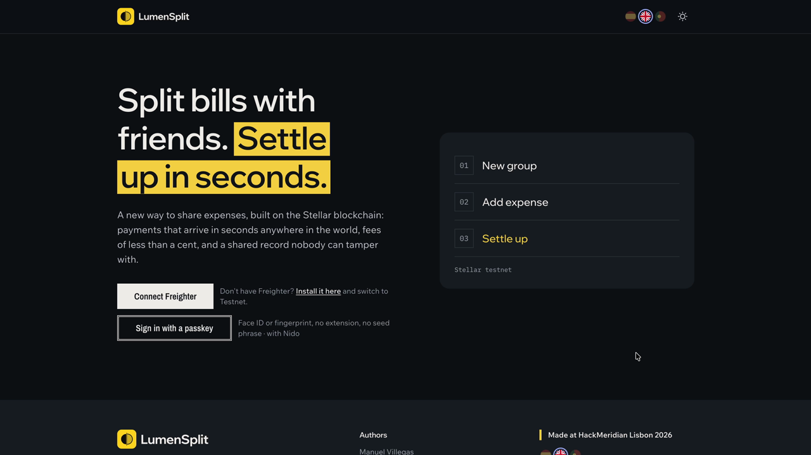
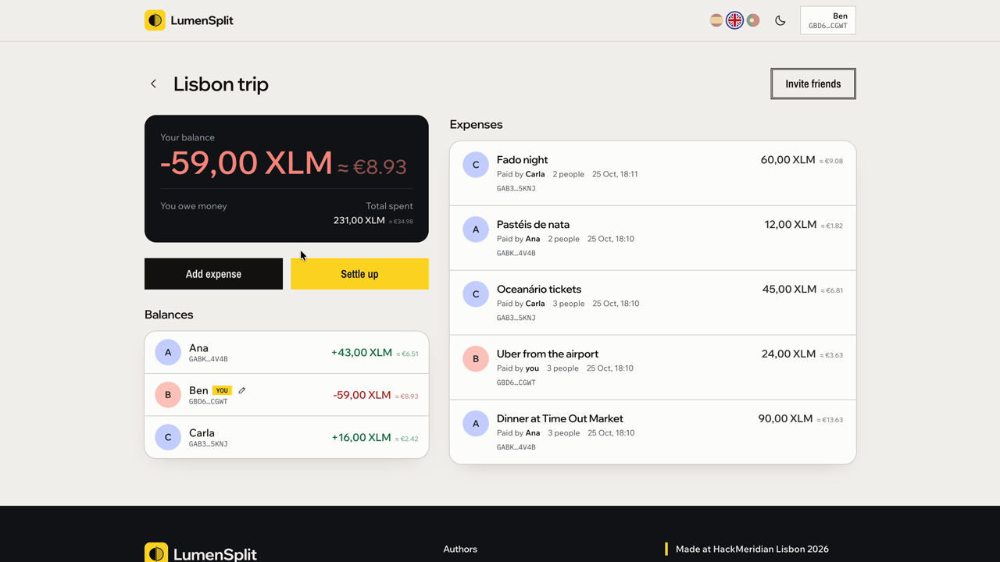
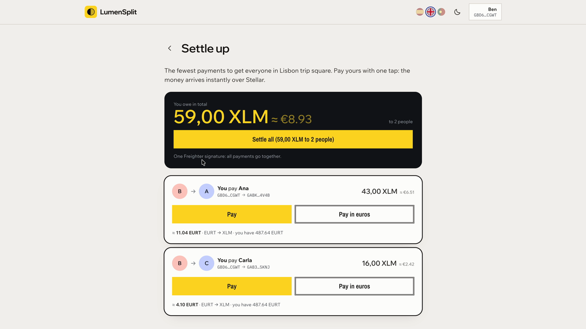
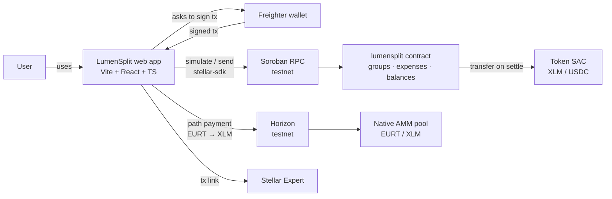
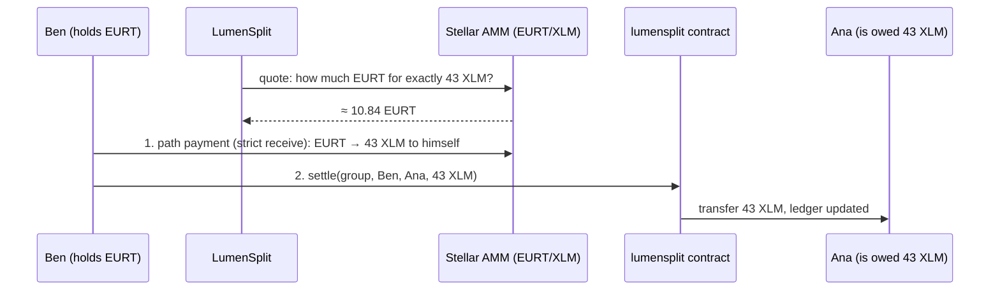

<a id="readme-top"></a>

<!-- PROJECT SHIELDS -->
<div align="center">

[![HackMeridian][hackmeridian-shield]][hackmeridian-url]
[![Stellar Testnet][stellar-shield]][contract-url]
[![Tests][tests-shield]](#-testing)
[![Languages][i18n-shield]](#-features)
[![MIT License][license-shield]][license-url]

</div>

<!-- PROJECT LOGO -->
<br />
<div align="center">
  <a href="https://github.com/manuuvllgs/LumenSplit">
    
  </a>

  <h3 align="center">Split bills with friends. Settle up in seconds, from anywhere.</h3>

  <p align="center">
    Shared expenses tracked in a Soroban smart contract, debts paid with real money on the Stellar network.
    <br />
    <a href="#-how-it-works"><strong>Explore how it works »</strong></a>
    <br />
    <br />
    <a href="https://lumensplit.vercel.app"><strong>🌐 Try the live app</strong></a>
    &middot;
    <a href="https://youtu.be/u57OSypg87w">🎬 Watch the demo</a>
    &middot;
    <a href="#-getting-started">🚀 Run it locally</a>
    &middot;
    <a href="#-smart-contract-api">📜 Contract API</a>
    &middot;
    <a href="https://github.com/manuuvllgs/LumenSplit/issues">🐛 Report a bug</a>
  </p>

  <sub>Built in 28 hours at <b>HackMeridian Lisbon 2026</b> · Track <b>Genesis</b> · Themes <b>Stellar Unlocked</b> & <b>Stellar Composed</b></sub>
</div>

<br />

<!-- TABLE OF CONTENTS -->
<details>
  <summary><b>📑 Table of contents</b></summary>
  <ol>
    <li>
      <a href="#-about-the-project">About the project</a>
      <ul>
        <li><a href="#the-problem">The problem</a></li>
        <li><a href="#our-solution">Our solution</a></li>
        <li><a href="#-features">Features</a></li>
        <li><a href="#-why-stellar">Why Stellar</a></li>
        <li><a href="#%EF%B8%8F-built-with">Built with</a></li>
      </ul>
    </li>
    <li><a href="#-demo">Demo</a></li>
    <li><a href="#-how-it-works">How it works</a></li>
    <li><a href="#-getting-started">Getting started</a></li>
    <li><a href="#-smart-contract-api">Smart contract API</a></li>
    <li><a href="#-engineering-notes">Engineering notes</a></li>
    <li><a href="#-testing">Testing</a></li>
    <li><a href="#-deployed-on-testnet">Deployed on testnet</a></li>
    <li><a href="#%EF%B8%8F-roadmap">Roadmap</a></li>
    <li><a href="#-team">Team</a></li>
    <li><a href="#-use-of-ai">Use of AI</a></li>
    <li><a href="#-license">License</a></li>
    <li><a href="#-acknowledgments">Acknowledgments</a></li>
  </ol>
</details>

<!-- ABOUT THE PROJECT -->
## 💡 About the project

### The problem

Trips, shared flats, Erasmus semesters: groups share expenses all the time. Expense apps keep track of who owes what, but **the payback happens somewhere else** ("I'll send it to you later"), and often it never happens.

Across borders it gets worse. An international student in Lisbon paying back a friend in Germany or Brazil faces slow transfers, FX spreads and fees that can be bigger than the debt itself. Small debts linger, and someone always ends up out of pocket.

### Our solution

**LumenSplit puts tracking and paying in the same place.** The group's ledger lives in a Soroban smart contract on Stellar, and every debt can be paid from inside the app in about 5 seconds, for a fraction of a cent.

```text
 Create a group  →  Log expenses  →  See who owes whom  →  Pay in one tap
   (link / QR)       (equal or         (fewest payments,      (XLM, or in euros
                      custom split)      computed on-chain)      via Stellar's AMM)
```

Nobody can rewrite the history, and every payment has a public receipt on the explorer.

### ✨ Features

| | Feature | What it means for the user |
|:--:|---|---|
| 🔗 | **Join by link or QR** | Invite friends with a link or a QR code. No copying `G…` addresses. The secret code never touches a server or the chain: only its SHA-256 hash is stored. |
| ⚖️ | **Equal or custom splits** | Split a bill equally, or give everyone a different amount ("I had the expensive dish"). The group ledger always sums to exactly zero. |
| 🧮 | **On-chain debt simplification** | The contract computes the fewest payments that bring everyone back to zero, so the whole group sees the same answer. |
| ⚡ | **Settle all, atomically** | Pay every debt you have in the group with **one signature**, in one transaction. All payments go through or none do. |
| 💶 | **Pay in euros** | Only hold euros? Stellar's built-in exchange converts them on the fly and your friend receives the exact amount owed. |
| 🛡️ | **Overpay protection** | You can only pay what you actually owe to someone who is actually owed. |
| 🔑 | **Passkey wallets** | No extension, no seed phrase: create a smart account with Face ID or Touch ID through [Nido](https://test.nido.fyi) by The Aha Company (HackMeridian partner), then authorize LumenSplit once, with a daily XLM limit the account enforces on-chain. Freighter works too. |
| 🙋 | **Names, not addresses** | Everyone picks a display name, stored on their own Stellar account. |
| 🌍 | **Español · English · Português** | The whole app is translated, with a flag switcher in the top bar. |
| 🌙 | **Light and dark mode** | Switch themes from the top bar. |
| 🍪 | **No cookies, no tracking** | Nothing to accept. The browser only remembers your connected account and language. |

### 🌟 Why Stellar

- **Instant and nearly free**: ~5 s finality and fees around 0.00001 XLM, so paying back 3 € finally makes sense.
- **Stablecoins**: a group can settle in USDC, so nobody is exposed to volatility.
- **Stellar Asset Contracts**: the contract moves native assets directly with `transfer`, without wrapping.
- **Path payments + native AMM**: pay in your currency and the network converts it at the best available rate, in the same few seconds.
- **Anchors** *(roadmap)*: cash out to a bank account.

### 🛠️ Built with

[![Stellar][stellar-badge]][stellar-url]
[![Soroban][soroban-badge]][soroban-url]
[![Rust][rust-badge]][rust-url]
[![React][react-badge]][react-url]
[![TypeScript][ts-badge]][ts-url]
[![Vite][vite-badge]][vite-url]
[![Tailwind CSS][tailwind-badge]][tailwind-url]
[![Freighter][freighter-badge]][freighter-url]

<p align="right">(<a href="#readme-top">back to top</a>)</p>

<!-- DEMO -->
## 🎬 Demo

<p align="center">
  <a href="https://youtu.be/u57OSypg87w">
    
  </a>
  <br>
  <a href="https://youtu.be/u57OSypg87w"><strong>▶ Watch the demo on YouTube (2:49)</strong></a> · <a href="https://github.com/manuuvllgs/LumenSplit/blob/main/docs/demo/lumensplit-demo.mp4">or the MP4 in this repo</a>
</p>

**Live app:** [lumensplit.vercel.app](https://lumensplit.vercel.app) (Stellar testnet; connect [Freighter](https://www.freighter.app/) on Testnet, or sign in with a passkey).

Balances computed by the contract, **Settle all** in one atomic transaction, invites by link or QR, custom amounts, **paying in euros** through Stellar's built-in exchange, and passkey wallets with [Nido](https://test.nido.fyi) by The Aha Company, in dark mode.

| Home | Group | Settle up |
|:---:|:---:|:---:|
|  |  |  |

Design wireframes: [`docs/wireframes/`](docs/wireframes/) · Brand kit: [`docs/brand/`](docs/brand/) · Video runbook: [`docs/demo-runbook.md`](docs/demo-runbook.md) · Video source (Remotion): [`video/`](video/)

<p align="right">(<a href="#readme-top">back to top</a>)</p>

<!-- HOW IT WORKS -->
## 🧭 How it works



| Layer | Where | What it does |
|---|---|---|
| **Contract** | [`contracts/lumensplit/`](contracts/lumensplit/) | Rust/Soroban. Stores groups, expenses, invites and a balance per member. Every expense keeps the ledger summing to zero. |
| **Frontend** | [`frontend/`](frontend/) | Vite + React + TypeScript + Tailwind. The contract client is built at runtime from the on-chain spec (`contract.Client.from`), so there is no code generation to keep in sync. |
| **Wallet** | [Freighter][freighter-url] | Signs every write. Reads are simulated, so they need no signature. |

### Pay in euros: a cross-currency settlement



Two signatures are needed because a Soroban contract call cannot share a transaction with classic operations. The path payment is *strict receive*: Ana gets the exact amount, and Ben's maximum spend is capped at the quote plus 1% slippage. Code: [`frontend/src/lib/pathpay.ts`](frontend/src/lib/pathpay.ts).

<p align="right">(<a href="#readme-top">back to top</a>)</p>

<!-- GETTING STARTED -->
## 🚀 Getting started

### Prerequisites

- [Rust](https://rustup.rs/) with the `wasm32v1-none` target
  ```sh
  rustup target add wasm32v1-none
  ```
- [Stellar CLI](https://developers.stellar.org/docs/tools/cli)
- [Node.js](https://nodejs.org/) 20+
- [Freighter][freighter-url] browser extension, set to **Testnet**

### 1. Contract

```sh
cargo test
stellar contract build
stellar contract deploy \
  --wasm target/wasm32v1-none/release/lumensplit.wasm \
  --source dev --network testnet --alias lumensplit
```

### 2. Demo data *(optional)*

```sh
# Demo accounts (testnet only)
for u in ana ben carla; do stellar keys generate $u --network testnet --fund; done

# Group "Lisbon trip" with 5 expenses: ana +43, ben −59, carla +16
./scripts/demo-seed.sh

# Demo euro (EURT), an EURT/XLM AMM pool, and 500 EURT per demo account
cd frontend
BEN_SECRET=$(stellar keys show ben) CARLA_SECRET=$(stellar keys show carla) \
ANA_SECRET=$(stellar keys show ana) node scripts/setup-eurt.mjs
```

Need a clean slate for a demo? `./scripts/reset-demo.sh` deploys a fresh contract instance and seeds it again.

### 3. Frontend

```sh
cd frontend
cp .env.example .env
npm install
npm run dev
```

<details>
  <summary><code>.env</code> keys</summary>

```ini
VITE_CONTRACT_ID=...                 # lumensplit contract
VITE_TOKEN_ID=...                    # settlement token SAC (native XLM on testnet)
VITE_NETWORK=testnet
VITE_RPC_URL=https://soroban-testnet.stellar.org
VITE_PAY_ASSET=EURT:<issuer>         # printed by setup-eurt.mjs; hides "Pay in euros" if empty
```
</details>

Open http://localhost:5173, connect Freighter on **Testnet** and create your first group. New testnet accounts are funded automatically.

<p align="right">(<a href="#readme-top">back to top</a>)</p>

<!-- CONTRACT API -->
## 📜 Smart contract API

| Function | Signature | What it does |
|---|---|---|
| `create_group` | `(creator: Address, name: String, token: Address, members: Vec<Address>) -> u32` | Creates a group. `token` is the settlement asset (XLM or USDC SAC). The creator signs and must be a member. |
| `add_expense` | `(group_id: u32, payer: Address, amount: i128, description: String, participants: Vec<Address>)` | The payer signs. Splits equally; the remainder goes to the first participants so the group always sums to 0. |
| `add_expense_custom` | `(group_id: u32, payer: Address, description: String, shares: Vec<Share{member, amount}>)` | The payer signs. Each participant owes a different amount; the total is the sum of the shares. |
| `settle` | `(group_id: u32, from: Address, to: Address, amount: i128)` | `from` signs. Transfers real tokens and updates balances. Only if `from` owes and `to` is owed; cannot overpay. |
| `settle_all` | `(group_id: u32, from: Address) -> Vec<Transfer>` | `from` signs once. Pays every debt `from` has, following `suggest_settlements`, in one atomic transaction. |
| `suggest_settlements` | `(group_id: u32) -> Vec<Transfer{from, to, amount}>` | Debt simplification: the minimal list of payments that leaves everyone at 0. |
| `create_invite` | `(group_id: u32, member: Address, code_hash: BytesN<32>)` | A member signs. Stores only the SHA-256 of a secret invite code; a new invite replaces the old one. |
| `join_group` | `(group_id: u32, member: Address, code: Bytes)` | The new member signs. Joins with balance 0 if `sha256(code)` matches. |
| `get_group` | `(group_id: u32) -> Group{id, name, token, members}` | Read |
| `get_balances` | `(group_id: u32) -> Map<Address, i128>` | Positive = is owed, negative = owes |
| `get_expenses` | `(group_id: u32) -> Vec<Expense{payer, amount, description, participants, shares, timestamp}>` | Read. `shares[i]` is what `participants[i]` owes. |
| `group_count` | `() -> u32` | Number of groups (ids go from 1 to N) |

Amounts are `i128` in the token's smallest unit (XLM and USDC use 7 decimals: 1 XLM = 10_000_000).

<details>
  <summary><b>Error codes</b></summary>

| Code | Error | Code | Error |
|:--:|---|:--:|---|
| 1 | `GroupNotFound` | 7 | `NothingToSettle` |
| 2 | `NotAMember` | 8 | `AmountTooLarge` |
| 3 | `InvalidAmount` | 9 | `SelfSettlement` |
| 4 | `NoParticipants` | 10 | `AlreadyMember` |
| 5 | `EmptyGroup` | 11 | `InvalidInvite` |
| 6 | `DuplicateMember` | 12 | `NoInvite` |

</details>

<p align="right">(<a href="#readme-top">back to top</a>)</p>

<!-- ENGINEERING NOTES -->
## 🔬 Engineering notes

> [!TIP]
> **Cutting the cost of creating a group from ~4,700 XLM to ~6 XLM.** Our first deployment extended the storage TTL of every entry to 90 days on every write. On testnet, the rent paid up front made `create_group` cost **4,701 XLM** in fees (measured on Stellar Expert), enough to drain a Friendbot account in two groups. We removed the per-write extensions and let new entries take the network's minimum lifetime. Creating a group plus two expenses now costs **~6.8 XLM**, about **700× cheaper**, with no change to the public API. A production version would extend TTL lazily, only when an entry is close to expiring.

- **The ledger always sums to zero.** Equal splits leave remainders (100 split by 3). The contract gives the extra units to the first participants, so balances are exact to the smallest unit and `suggest_settlements` can always clear the group.
- **Debt simplification** matches the largest debtor with the largest creditor until everyone is at zero, which needs at most *members − 1* transfers.
- **Invite links without leaking the code.** The link looks like `https://app/join/7#<code>`. Everything after `#` stays in the browser and is never sent to a server. The contract only stores `sha256(code)`, so reading the chain does not reveal how to join a group.
- **One code path for every split.** Equal and custom expenses go through the same internal function, and so do `settle` and `settle_all`, so the rules can never drift apart.

<p align="right">(<a href="#readme-top">back to top</a>)</p>

<!-- TESTING -->
## 🧪 Testing

```sh
cargo test
```

**15 unit tests** cover group creation, equal splits and remainders, custom splits and their validation, outsiders being rejected, settlement moving real tokens, overpay protection, `settle_all` paying several creditors in one call, invites (valid code, wrong code, no invite, already a member, non-members creating invites) and suggested settlements clearing all debts.

<p align="right">(<a href="#readme-top">back to top</a>)</p>

<!-- DEPLOYED -->
## 🌐 Deployed on testnet

| What | ID |
|---|---|
| LumenSplit contract | [`CBCRUQ2EQXN6E7YCNM2K3M2NHUU6IZUZWX65PAVROL2VWQC2DCWWYNEX`][contract-url] |
| Settlement token (native XLM SAC) | [`CDLZFC3SYJYDZT7K67VZ75HPJVIEUVNIXF47ZG2FB2RMQQVU2HHGCYSC`](https://stellar.expert/explorer/testnet/contract/CDLZFC3SYJYDZT7K67VZ75HPJVIEUVNIXF47ZG2FB2RMQQVU2HHGCYSC) |
| Demo euro asset (EURT) | [`EURT:GARXWCPKKRVKGJ5D2ESLXF4LZKN5PFTSB5Z6WJK72RBUJV5TB33GP5B2`](https://stellar.expert/explorer/testnet/asset/EURT-GARXWCPKKRVKGJ5D2ESLXF4LZKN5PFTSB5Z6WJK72RBUJV5TB33GP5B2) |
| EURT/XLM liquidity pool | [`e81a98ae…221382e6`](https://stellar.expert/explorer/testnet/liquidity-pool/e81a98ae098802a5b8412fd30cd9ec8c1b813b59c27bc147768adb8a221382e6) |

> [!NOTE]
> EURT is a demo token we issued on testnet to make cross-currency payments reproducible. In production the same code works with EURC or USDC, since the network finds the path at payment time.

<p align="right">(<a href="#readme-top">back to top</a>)</p>

<!-- ROADMAP -->
## 🗺️ Roadmap

- [x] Groups, equal and custom expenses, balances
- [x] On-chain debt simplification
- [x] Real payments on testnet, with overpay protection
- [x] Settle all debts in one atomic transaction
- [x] Invite friends by link or QR (hashed codes)
- [x] Pay in euros through path payments and the native AMM
- [x] Spanish, English and Portuguese
- [x] Passkey smart wallets with Nido, so friends don't need to install anything
- [ ] Real stablecoins (EURC, USDC) as group and payment assets
- [ ] "Settle all in euros" in one tap
- [ ] Cash out to a bank account through Stellar anchors (SEP-24)
- [ ] Recurring expenses and percentage splits
- [ ] Mainnet and mobile app

<p align="right">(<a href="#readme-top">back to top</a>)</p>

<!-- TEAM -->
## 👥 Team

<table>
  <tr>
    <td align="center" width="33%">
      <b>Manuel Villegas</b><br />
      <sub>Soroban contract · deployment · integration</sub>
    </td>
    <td align="center" width="33%">
      <b>Gregorio Torres</b><br />
      <sub>Frontend · UX</sub>
    </td>
    <td align="center" width="33%">
      <b>Alejandro Teva</b><br />
      <sub>Design · pitch · demo video</sub>
    </td>
  </tr>
</table>

Project link: [github.com/manuuvllgs/LumenSplit](https://github.com/manuuvllgs/LumenSplit)

<p align="right">(<a href="#readme-top">back to top</a>)</p>

<!-- AI -->
## 🤖 Use of AI

In line with the hackathon rules, we used AI assistants during development. Claude (Anthropic) helped with contract code review and tests, frontend scaffolding and integration code, translations, the visual identity (palette, logo, wireframes), and drafting this README, the pitch deck and the video script. All AI output was reviewed, tested and edited by the team.

<!-- LICENSE -->
## 📄 License

Distributed under the MIT License. See [`LICENSE`](LICENSE) for more information.

<!-- ACKNOWLEDGMENTS -->
## 🙏 Acknowledgments

- [Stellar Development Foundation](https://stellar.org) and the [HackMeridian][hackmeridian-url] organisers, mentors and judges
- [Stellar developer docs](https://developers.stellar.org) and [Stellar Expert](https://stellar.expert)
- [Freighter](https://www.freighter.app/) wallet

<p align="right">(<a href="#readme-top">back to top</a>)</p>

<!-- MARKDOWN LINKS & IMAGES -->
[hackmeridian-shield]: https://img.shields.io/badge/HackMeridian-Lisbon%202026-5b4bff?style=for-the-badge
[hackmeridian-url]: https://www.hackmeridian.com/
[stellar-shield]: https://img.shields.io/badge/Stellar-testnet-ffc23d?style=for-the-badge&logo=stellar&logoColor=black
[contract-url]: https://stellar.expert/explorer/testnet/contract/CBCRUQ2EQXN6E7YCNM2K3M2NHUU6IZUZWX65PAVROL2VWQC2DCWWYNEX
[tests-shield]: https://img.shields.io/badge/tests-15%20passing-2ea44f?style=for-the-badge
[i18n-shield]: https://img.shields.io/badge/i18n-ES%20·%20EN%20·%20PT-15132e?style=for-the-badge
[license-shield]: https://img.shields.io/badge/license-MIT-blue?style=for-the-badge
[license-url]: LICENSE

[stellar-badge]: https://img.shields.io/badge/Stellar-000000?style=for-the-badge&logo=stellar&logoColor=white
[stellar-url]: https://stellar.org
[soroban-badge]: https://img.shields.io/badge/Soroban-5b4bff?style=for-the-badge
[soroban-url]: https://developers.stellar.org/docs/build/smart-contracts/overview
[rust-badge]: https://img.shields.io/badge/Rust-000000?style=for-the-badge&logo=rust&logoColor=white
[rust-url]: https://www.rust-lang.org
[react-badge]: https://img.shields.io/badge/React-20232A?style=for-the-badge&logo=react&logoColor=61DAFB
[react-url]: https://react.dev
[ts-badge]: https://img.shields.io/badge/TypeScript-3178C6?style=for-the-badge&logo=typescript&logoColor=white
[ts-url]: https://www.typescriptlang.org
[vite-badge]: https://img.shields.io/badge/Vite-646CFF?style=for-the-badge&logo=vite&logoColor=white
[vite-url]: https://vite.dev
[tailwind-badge]: https://img.shields.io/badge/Tailwind_CSS-06B6D4?style=for-the-badge&logo=tailwindcss&logoColor=white
[tailwind-url]: https://tailwindcss.com
[freighter-badge]: https://img.shields.io/badge/Freighter-wallet-6c47ff?style=for-the-badge
[freighter-url]: https://www.freighter.app/
